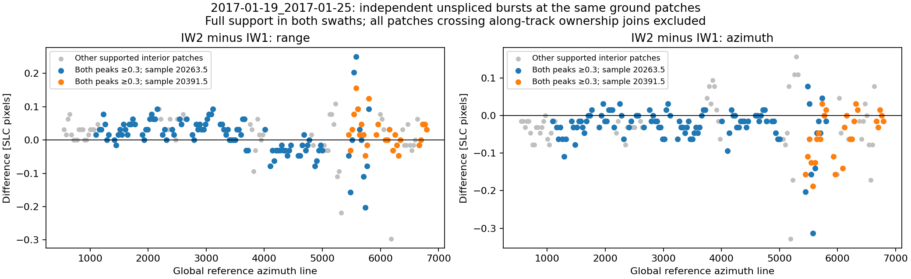

# Glacier offsets: engineering and scientific hand-off

**Snapshot:** 2026-10-24, Asia/Shanghai.  
**Repository:** `/Users/briel/data/insar/glacier_offsets`  
**Branch:** `codex/isce2-merge-first`  
**Latest code commit:** `ccd8c7b` — `Add selectable stack merging and matching strategies`.

This hand-off describes the code and inspected local products at that revision.
It is a documentation follow-up to the code commit. Dataset status and local
configurations can change; inspect the saved manifests before continuing work.
The numerical evidence needed for the latest conclusions is copied into
[`handoff-2026-10-24/`](handoff-2026-10-24/), including a [state snapshot](handoff-2026-10-24/state.json).
The much larger working experiments remain in ignored local directories.

## 1. What the next person needs to know first

The current working workflow retains **merge-first processing**: align bursts
with COMPASS, prepare their valid coverage, assemble complex SLCs, run native
ISCE3 Ampcor, and geocode the resulting radar offsets. CPU workers partition
matching work but still read the merged SLCs across their scheduling boundaries.

The January Larsen pilot is complete with:

```yaml
stack:
  processing: isce2_merge_first
  swath_merge: midpoint
matching:
  engine: isce3
  backend: cpu
  deramp: 0
  zoom: 16
```

This means ISCE2-style stack-common validity, later-burst overwrite within each
swath, and an interior range midpoint between adjacent swaths. The merge and
validity preparation are Python/NumPy/GDAL implementations. **This configuration
does not call ISCE2.** The name `isce2_merge_first` identifies the preparation
strategy, independently of the selected matcher.

The large false azimuth burst/swath stripes are substantially improved in the
newer workflows. A small range-swath contrast remains. Moving the cross-swath
cut into the overlap interior made little visible difference on the latest
reviewed pair. Do not describe the midpoint option as a demonstrated cure for
that remaining contrast.

The latest diagnostic matched the same ground patches independently in IW1 and
IW2 using unspliced aligned bursts. Differences exist **before any splicing**
and persist away from along-track burst joins. They vary spatially and change
sign. This identifies a pre-merging component; it does not identify its physical
or numerical cause or establish which swath is correct.

The user has substantial experience with ISCE2/ISCE3, including three years at
JPL, and trusts the ISCE3 Ampcor implementation. The engineering priority is
input preparation, validity, ownership, and controlled comparisons. There is
no demonstrated reason to replace or port the ISCE3 kernel.

## 2. Purpose and scientific conventions

The project performs Sentinel-1 TOPS amplitude offset tracking for individual
pairs and reference-geometry stacks. Outputs include sparse radar offsets,
geocoded displacement/velocity rasters, support and quality masks, provenance,
and diagnostic figures.

Important conventions:

- Arrays and parameter pairs use **azimuth, range** order.
- Offsets are **later minus earlier**, on the pinned stack-reference radar grid.
- `total = gross + residual`; zero, constant and velocity-guided priors are
  supported by the production workflow. Missing velocity-prior coverage stays
  missing rather than silently becoming a zero prior.
- Range/azimuth velocity components are radar-direction observables, not east
  and north velocity components.
- Exact per-burst acquisition intervals are retained for physical scaling.
- A matching center is the zero-based full-resolution chip start plus
  `(window - 1) / 2`. Center coordinates must not shift when work is partitioned.
- Raw observations and quality masks are retained separately. A zero quality
  threshold does not establish scientific accuracy.
- `geocoding.mask: input` is the current default. Diagnostic threshold changes
  alone do not necessarily change the delivered map's source selection.

COMPASS supplies geometry-only coregistration. This is not a full ISCE2
coregistration/NESD reproduction, and the workflow does not perform time-series
inversion or establish absolute velocity accuracy.

## 3. Inspected datasets and current local state

### Main inputs and outputs

| Item | Location or value |
| --- | --- |
| Download collection | `/Volumes/thinkplus/insar/glacier_offsets/data/larsen/burst-downloads` |
| Download manifest | `.../burst-downloads/download_manifest.json` |
| Reconstructed SAFE inventory | `.../burst-downloads/safe` |
| Prepared orbit files | `/Volumes/thinkplus/insar/glacier_offsets/data/larsen/prepared-bursts/orbits` |
| DEM | `/Volumes/thinkplus/insar/glacier_offsets/data/larsen/prepared-bursts/dem/elevation_LOCAL_ccd312faa65c.tif` |
| AOI | `/Volumes/thinkplus/insar/glacier_offsets/data/larsen/LAR2_large.kml` |
| Track / polarization | Relative orbit 38 / HH |
| Bursts in the pilot | `t038_080975` through `t038_080979`, each in IW1 and IW2: ten source IDs |
| Reference date | 2017-01-01 |
| Pilot dates | 2017-01-01, 07, 13, 19, 25, 31 |
| Pilot output root | `/Volumes/thinkplus/insar/glacier_offsets/work/larsen/stack-isce2` |
| Original annual root | `/Volumes/thinkplus/insar/glacier_offsets/work/larsen/stack` |
| Radar grid | 7,336 lines × 44,088 samples |
| Matching grid | 227 × 342 = 77,634 windows |
| Geocoding | EPSG:3031, 200 m spacing, nearest resampling |

At inspection, the pilot catalog reports `outcome: complete`, six active
acquisitions and five complete adjacent pairs. Its saved ownership method is
`isce2-common-valid-burst-overwrite-swath-midpoint-v1` and its saved matcher is
ISCE3 magnitude-first.

The original annual root has 61 active acquisitions and 60 active pair entries:
49 complete, one interrupted and ten stale. Its overall outcome is interrupted;
the interrupted pair is `2017-10-22_2017-10-28`. It uses the older
`reference-swath-interior-midpoint-v2` policy. Preserve it as historical evidence;
do not treat the whole annual stack as complete.

The root name `stack-isce2` does **not** identify its current matching engine.
That root first held ISCE2 matches, then ISCE3 matches with full overwrite, and
now ISCE3 matches with interior swath cuts. Pair products were replaced during
these transitions. Some earlier baselines survive only in isolated experiments
and numerical reports, not as complete production trees.

### Local configuration inheritance: a practical trap

The following files are local/generated and intentionally ignored by Git:

| Config | Meaning |
| --- | --- |
| `configs/stack.larsen.yaml` | Base pilot inputs, Jan 1–31 filters, shared output root; implicit ISCE2 engine and zoom 8 |
| `configs/stack.larsen.isce3-matcher.yaml` | Extends base; explicitly selects ISCE3, CPU, `deramp: 0`, zoom 16 |
| `configs/stack.larsen.swath-midpoint.yaml` | Extends ISCE3 config; selects `swath_merge: midpoint`; matches the current pilot root |
| `configs/stack.larsen.isce3.yaml` | Earlier saved copy of the original configuration; inspect before using |

`run.sh` still sets `CFG="configs/stack.larsen.yaml"`. It does not select the
current midpoint configuration. Its shell `START` and `END` variables occur in
commented download examples and do not override the stack YAML date filters.
Use the current explicit config below when resuming the pilot. Do not infer
current settings from `run.sh`, directory names, or inherited defaults alone.

The tracked portable template is `configs/stack.isce2.example.yaml`.

## 4. How the problem evolved

### Earlier input, support and recovery issues

The work before the latest branch established restartable ASF burst downloads,
SAFE reconstruction, input preparation, stack planning, status inspection, and
bounded storage. Relevant fixes include:

- Compact download-plan output became the default; detailed selections and
  expected SAFE directories remain available through the downloader tooling.
- Repeated download interruption/resume retains completion evidence for groups
  not yet rechecked, then verifies their files before reuse. A resumed run must
  not discard durable completion markers merely because it was interrupted again.
- Managed collections validate the manifest, registered SAFE files and checksums.
  `prepare-inputs` rejects running/incomplete collections. Remounting a volume
  does not by itself prove collection integrity; rerun the owning downloader to
  reconcile a stale collection state.
- `--allow-partial` can retain usable contiguous coverage and record omissions.
  A valid reconstructed SAFE still needs contiguous burst sequences; retaining
  every disconnected product is not always possible. Missing pair coverage stays
  nodata. Inspect the saved plan rather than assuming a fixed temporal separation
  after dropping dates or bursts.
- Assembled burst2safe annotations can contain two geolocation records for one
  internal burst-boundary line/pixel. `annotation_geometry.py` now recognizes
  this constrained case, normalizes an in-memory copy using the following burst's
  timestamp, and validates the resulting footprints. It does not average arbitrary
  conflicting polygons or rewrite the downloaded source annotations. Conflicts
  outside the time/ground-distance tolerances are still errors. This was an
  interpretation problem in our scripts, not a reason to redownload imagery.
- The plan plotting tools expose temporal links, disconnected components and
  shared usable coverage. A chronological gap plot is not by itself evidence of
  a usable matching link.

These are supporting improvements already committed before the current
merge/matcher implementation. Their detailed operational documentation is in
`README_DETAILED.md` and `GETTING_STARTED.md`.

### Apparent support holes and actual matching artifacts were separate issues

Early masks treated isolated quantized complex zeros as missing data. Reference
ownership then removed otherwise usable samples from both dates. The shared
support policy now distinguishes isolated zeros from connected zero fill:
nonfinite values and explicit invalid masks are rejected; a 3×3 zero region or
boundary-connected zero component seeds missing-support detection. Explicit
isolated holes remain invalid.

A separate cross-swath issue selected a strip of missing IW2 near-range data
although IW1 supported that area. Interior swath ownership recovered 327 windows
in the recorded January 1–7 support experiment, with none lost. This established
support recovery, not displacement accuracy.

Later inspection found real matching artifacts in radar offsets, before
geocoding. In a PIG control, splicing a weak lower-burst amplitude edge into both
dates created an artificial stationary feature: an approximately 5.19-pixel
azimuth displacement measured from the upper burst became approximately
0.17 pixels in the merged input. Moving that specific splice into supported
interior coverage restored agreement with the upper-only control. Magnitude-first
processing alone did not repair that example.

The Larsen March 14–20 pair still showed seams after support fixes. Controlled
merged/unspliced and complex/magnitude preprocessing experiments reduced some
stripes but retained cross-swath differences. This led to the ISCE2 source audit
and the current preparation strategy.

## 5. What the ISCE2 comparison actually established

The local source review followed:

- `/Users/briel/src/isce2-official/contrib/stack/topsStack/mergeBursts.py`
- `VRTManager.py`, `Stack.py`, `resamp_withCarrier.py`,
  `s1a_isce_utils.py`, and `extractCommonValidRegion.py` in that checkout.

The active topsStack path constructs ordered GDAL VRT `SimpleSource` rectangles.
Later sources overwrite earlier ones, including later bursts within a swath and
IW2 over IW1. The separate NumPy function with `top/bot/avg` handling is not the
active VRT path followed by the inspected `main`; a `--method` spelling alone
was misleading evidence about actual precedence.

The upstream valid rectangles are also significant: secondary validity is
adjusted using actual resampling offsets and interpolation margins, then common
validity is intersected across the stack. Our earlier reference-only midpoint
policy did not reproduce that preparation.

A controlled execution of the official VRT builder with the March pair's
reference rectangles changed 11,844,809 SLC ownership pixels and 2,895 matching
centers relative to our earlier owner raster. This isolated a merge-policy
difference; it did not recreate an entire native ISCE2 stack or prove those
ownership choices universally superior.

An actual ISCE2 CPU magnitude matcher was added to provide a reference run.
It was subsequently decoupled from preparation. ISCE3 already supports
magnitude-first input detection through `derampMethod=0`; it need not call
ISCE2 to use the same validity/ownership preparation.

Earlier discussion considered detailed kernel differences as possible causes.
That was not established as the explanation for the seams. Do not turn source
implementation differences into a diagnosis without a controlled result.

## 6. Implemented strategies and invariants

### Configuration and compatibility

| Setting | Behavior |
| --- | --- |
| `stack.processing: isce3` | Existing reference-support strategy, azimuth and swath interior midpoint ownership |
| `stack.processing: isce2_merge_first` | Stack-common, resampling-adjusted valid rectangles and merge-first processing |
| `stack.swath_merge: overwrite` | Default under the common-valid strategy: later sources overwrite within and between swaths |
| `stack.swath_merge: midpoint` | Later bursts overwrite within swaths, then adjacent swath support is split at an interior range midpoint |
| `matching.engine: isce3` | Native ISCE3 matcher; CPU worker scheduling or supported CUDA backend |
| `matching.engine: isce2` | Actual ISCE2 CPU magnitude Ampcor through an isolated interpreter |

For compatibility, omitting `matching.engine` under `isce2_merge_first` selects
ISCE2. Explicit engine choices, including inherited choices, are honored.
Other stacks default to ISCE3. `swath_merge: midpoint` is rejected unless the
common-valid preparation strategy is selected.

All strategies retain complete chips/search windows, fixed ownership, exact
centers, geometry/source consistency, raw observations, and missing-data masks.
Missing imagery does not trigger substitution from another burst on a particular
date. CPU partition boundaries never create artificial image boundaries.

### Common validity

`stack_isce2.py` ports `adjustValidSampleLine_V2`, including its four/eight-pixel
margins, sign-dependent offset-extrema handling, and reference-window behavior
for uncovered zero-extrema cases. Physical output bounds are also enforced.
A direct development comparison passed 1,000 nominal in-bounds cases against
the upstream helper; permanent tests cover the important contracts.

COMPASS offsets already refer to secondary-local indices. Do not add ISCE2's
separate relative-burst shift again. Offset rasters and their supporting files
are registered and checksummed alongside aligned SLCs.

All active dates must be aligned before common preparation. Complete dates
participate in the common intersection. A partial date is excluded as a whole
from that intersection but can contribute its available imagery later. A failed
alignment blocks preparation rather than silently shrinking the inventory.
An empty intersection is an error.

Changing the active inventory can change common windows and invalidate layout,
assemblies and pair products without changing the underlying COMPASS alignment.
The initially established map extent is retained. Inventory-only changes with
identical common windows do not unnecessarily rewrite the ownership raster.

### Cross-swath midpoint option

The implementation resolves later-source precedence **within each swath first**,
then sweeps the resulting support intervals in azimuth and partitions adjacent
swath overlaps in range. It keeps unshared coverage and verifies a disjoint
partition with no holes or duplicate ownership. At least 16 range samples of
overlap are required, giving an eight-sample margin on each side of the cut.
This margin is not a substitute for full date-specific chip/search support.

For the January pilot, the range cuts are 20,300, 20,350 and 20,395 in successive
azimuth intervals. No azimuth midpoint cuts are introduced. Both SLC assembly
and geometry use these same source regions.

### Actual ISCE2 engine

`isce2_worker.py` calls `mroipac.ampcor.Ampcor`, the Fortran kernel used by
DenseAmpcor, with both input types set to `mag`. It preserves our explicit grid
instead of using DenseAmpcor's automatic-grid/fork wrapper. The adapter handles
Fortran indexing, native reported centers, gross/total/residual accounting and
range/azimuth covariance order. Raw oversampling is two. `zoom` and
`oversampling` map to the native refinement parameters; `deramp` and `batch`
do not control this engine.

ISCE2 does not expose the refined normalized correlation peak. That field is
NaN with explicit provenance and is not used as a rejection criterion. Select
`correlation_threshold: 0` for this engine; SNR/covariance remain available.
GPU requests are rejected rather than silently falling back to ISCE3.

The ISCE2 engine is a diagnostic/compatibility option, not a requirement of the
current Larsen setup.

## 7. Latest experiments and what they mean

### A. Full-pair matcher selection: January 1–7

A separate comparison rebuilt temporary SLCs from retained bursts using the
same common-valid overwrite layout. Their checksums exactly matched the saved
ISCE2 baseline assemblies. ISCE3 used the same centers, ownership, seam labels
and input-validity mask. It matched 77,634 windows in approximately 55 seconds of
native-worker wall time with eight workers; input/mask preparation took additional
time. ISCE2 CPU matching for the earlier baseline had taken roughly half an hour
on this workload.

The ISCE2 baseline accepted 66,992 windows and the ISCE3 comparison accepted
69,525. These counts reflect different native acceptance/output behavior and
are not evidence that the additional observations are accurate. On their 66,990
common accepted windows, median signed differences were zero, but 90th-percentile
absolute differences were 0.219 azimuth and 0.172 range pixels. The implementations
were not bitwise equivalent on this experiment.

The broad boundary improvement persisted with ISCE3. This established that an
ISCE2 runtime is unnecessary for the preparation strategy. It did not establish
absolute accuracy or complete seam removal.

### B. Cross-swath midpoint: January 19–25

The isolated full-pair check changed only cross-swath ownership under the same
common validity and ISCE3 magnitude settings. It retained all 69,535 valid
windows with no input coverage gained or lost, kept the radar grid and centers,
and changed 396 center swath owners. Along-track owners were unchanged.

The subsequent production run completed all five January pairs under this
policy. The overall visual change on January 19–25 was small. In the 1,051-window
reviewed boundary band, median absolute range change was 0.015625 pixels and
the 90th percentile was 0.0625 pixels. Most of the image is unaffected. The
remaining broad swath contrast was not removed.

The four-worker isolated preview and eight-worker production run agree in masks,
centers and ownership. At 21 valid azimuth and 26 valid range centers they differ
by at most 0.015625 pixels, one 1/64-pixel refinement increment. Correlation values
also have small floating differences. Do not demand exact floating-point equality
across all native batching/worker arrangements.

The earlier narrow-strip result was correctly described as closer to the original
midpoint range result, but its likely visual benefit was overstated. Keep that
correction in the hand-off: the new option is implemented and validated as a
controlled policy choice, not a demonstrated scientific cure.

### C. Independent IW1/IW2 overlap matching: January 19–25

This is the latest and most useful result for the unresolved question.
`tools/compare_swath_overlap.py` reads the original aligned burst TIFFs on both
dates, never assembled SLCs, and runs native ISCE3 magnitude matching at the saved
global reference centers translated exactly into each burst's local grid.

Selection is established from input support before examining offset agreement.
All native burst observations are saved. For a unique comparison per swath and
center, the latest fully supported burst is selected before native quality is
considered. This is diagnostic sampling, not a production fallback policy.
No agreement gate is used. Separate summaries show all valid observations and
both-peak thresholds of 0.3 and 0.5.

Results:

| Check | Result |
| --- | ---: |
| Dual input-supported/native-valid centers | 211 / 211 |
| Supported centers away from along-track ownership joins | 187 |
| Interior centers with both correlation peaks ≥0.3 | 128 |
| Shared global range-center samples | 20,263.5 and 20,391.5 |
| Median center separation in reference geometry | 0.002962 m |
| Maximum center separation | 0.005645 m |
| Maximum chip-corner separation | 0.006664 m |

These geometry distances verify internal correspondence of the patches in the
reference geometry; they are not absolute geolocation-accuracy estimates.
The overlap is narrow relative to the 256-sample chip plus ±40-sample search,
which explains why only one or two production-grid columns support both swaths.

For the 128 interior, both-peak-≥0.3 comparisons, differences are **IW2 minus IW1**:

| Component | Median signed (px) | Median absolute (px) | 90th-percentile absolute (px) |
| --- | ---: | ---: | ---: |
| Range | +0.015625 | 0.031250 | 0.078125 |
| Azimuth | −0.015625 | 0.031250 | 0.098438 |

The range differences change sign along track. For example, burst-pair summaries
with both peaks ≥0.3 have positive medians of 0.03125–0.046875 pixels in earlier
sections and −0.03125 pixels for two later combinations. These particular
burst-pair summaries include supported joins; use the explicit interior group
for the join-excluded aggregate above. Even the stricter ≥0.5 interior subset
has nonzero differences (32 samples), so a higher correlation cutoff does not
by itself demonstrate removal of this effect.

**Conclusion:** there is a difference in the independent swath observations
before splicing, including away from along-track joins. A merge-cut change
cannot remove that component. This does not establish a constant swath bias,
identify the originating preparation/data effect, prove which estimate is
correct, or show that every visible discontinuity has one cause.



All source product sizes and nanosecond mtimes remained unchanged during the
completed diagnostic. No production offsets or masks were modified.

## 8. Performance, storage and operational improvements

### Parallelism

Preparation stages, acquisition dates and date pairs remain sequential. Native
multithreading is available in those stages. Stack CPU matching uses the first
`OMP_NUM_THREADS` level as a maximum process budget, capped by runnable bursts.
Each matching child has one OpenMP/BLAS thread. Workers are recycled after four
native calls to bound native allocation accumulation; FFTW planning information
is cached safely across workers.

A previous long single-worker tail was caused by assigning large unowned/missing
regions to one worker. A shared queue now distributes bounded pieces of that
work while retaining burst lanes and scientific ownership. Scheduling boundaries
do not crop matching halos or switch inputs to unspliced SLCs.

The ISCE2 adapter uses independent single-threaded subprocesses over merged-image
segments. In the long January 1–7 run, those workers were actively correlating,
not stuck in common-validity preparation. A sampled worker spent approximately
93% of CPU samples in the native correlation routine. The final offset product
waited for all segments. Matching-stage logging was added, but granular ISCE2
segment/row progress remains an observability improvement worth considering.

### Verification overhead

`ChecksumCache` is invocation-local. Every lookup checks the file stamp; unchanged
files shared by manifests/stages are hashed once in that invocation. Changed
files are rehashed and changes during hashing are rejected. A restart can still
read many GB because there is deliberately no persistent trust-by-mtime checksum
cache. A busy single parent during verification is not evidence that the matching
process budget has failed.

### Storage lifecycle

- `geometry/` holds the shared reference burst products, their geometry and
  radar grids, plus the assembled ownership raster/VRTs and map metadata.
- `acquisitions/<date>/bursts/` holds aligned burst SLCs, resampling offsets,
  validity information and completion/provenance manifests.
- `acquisitions/<date>/slc.tif` is a temporary merged SLC, with an external TIFF
  mask, validity raster and a small preview retained for diagnostics.
- `pairs/<earlier>_<later>/` holds matching outputs, maps and diagnostics.

With `storage.keep_merged_slcs: false`, each merged acquisition is assembled at
first needed use and released after its last planned matching consumer commits
offsets. Failed consumers keep required SLCs available. Later reruns can rebuild
released assemblies from aligned bursts without repeating COMPASS. Intentional
release is journaled so it is distinguishable from accidental file loss.

Per-burst coregistration products remain retained. They still dominate a large
stack's long-term storage; the merged-SLC cleanup does not eliminate that cost.
The user reduced processing to one-year/one-month subsets because of disk space.
Cross-root/year verified coreg import is not implemented. The in-place ownership
rebuild is not a general importer, and independently selecting references for
separate years does not guarantee identical geometry.

On macOS, the native CPU controller effectively requires a contiguous GDAL
memory map despite `useMmap=0`. Materialized stripped complex TIFFs use external
masks so mask/image blocks do not become interleaved. A Python probe reports
unsupported layouts before a native fatal failure.

## 9. Rebuild, invalidation and recovery contracts

`stack rebuild-layout` performs an explicit, journaled ownership-only migration.
It supports the older legacy midpoint-policy repair and switching between the
two common-valid swath policies. It is not a general migration from legacy
reference validity into common validity.

The preflight verifies reference pins, input/selection/software compatibility,
native products, aligned inventories and path ownership. It preserves COMPASS
reference/aligned products, resampling offsets and per-date validity metadata.
It rekeys their completion identities, stages new ownership/geometry, and removes
registered temporary assemblies and pair outputs. The catalog is committed last.

Important recovery behavior:

- A dry run verifies and reports without applying the change.
- `.layout-rebuild/journal.json` records an applying/complete transaction;
  `.layout-rebuild/before.json` retains previous metadata, not a complete backup
  of deleted pair rasters.
- Normal writers refuse an unfinished rebuild. Rerun the same rebuild command
  to resume, including after repeated interruptions.
- Completed burst caches of an incompletely marked acquisition are reused.
- macOS AppleDouble files and `.DS_Store` are ignored as filesystem metadata.
  Unregistered pair output directories still abort the preflight.
- Cleanup tolerates sidecars disappearing as macOS removes associated files;
  genuine permission errors leave a resumable journal rather than being hidden.
- `--force` is not a bypass for incompatible pinned reference geometry.
- A stack-directory lock prevents concurrent writers. Read-only status does
  not rediscover inputs, hash all products or start a native matcher.

Changing only the engine invalidates matching and downstream products while
preserving reference preparation and alignment. Changing the ownership policy
requires the supported rebuild or a new root. If a previous result is needed
for a controlled comparison, preserve its actual rasters before replacement;
metadata and a directory name are insufficient.

### Recognizable failure messages

| Message or symptom | Interpretation and recovery |
| --- | --- |
| `Output collection must be empty or contain a download manifest` | The downloader was pointed at a nonempty unmanaged directory. Confirm the intended managed collection root; do not manufacture a manifest or delete preserved imagery to bypass the guard. Finder metadata is handled separately. |
| `Burst collection is running, failed or incomplete; rerun download-bursts` | Preparation has encountered an uncommitted collection state. Reconcile it through the same downloader request, including `--allow-partial` when required by that collection. Remounting a disk alone is not completion evidence. |
| `Interior ownership requires time-ordered, non-nested reference bursts` | Historical overlap handling mixed interleaved swaths or incompatible ordering/support. Current grouping distinguishes swaths; inspect the radar placements and policy rather than forcing a global cut across unrelated sources. |
| `Unregistered pair output .../._YYYY-MM-DD_YYYY-MM-DD` | Historical Finder-sidecar rebuild failure. The current implementation ignores recognized metadata files but still rejects genuine unregistered pair directories. |
| Missing derived paths during rebuild cleanup | Retry the same journaled rebuild after resolving volume availability. Already-deleted derived files are tolerated; persistent permission or I/O errors are not hidden. |
| Pinned reference inputs/software/support policy changed | Normal processing refuses the mismatch. Use only a supported ownership rebuild with unchanged reference inputs, or create a genuinely new stack root. |
| GDAL virtual-memory / native CPU mapping failure | Check for a contiguous stripped complex TIFF with an external validity mask. `useMmap=0` does not disable the installed native controller's mapping requirement. |
| One busy parent and no matching workers after restart | Inspect the logged stage. Integrity hashing and support preparation can run in the parent before matching starts; the process count alone is not a deadlock diagnosis. |

## 10. Commands for the current machine

Run these from the repository using the ISCE3 environment. Local config paths
resolve relative to the YAML that declares them; inherited paths retain their
original declaration context.

### Inspect or resume the current pilot

```bash
cd /Users/briel/data/insar/glacier_offsets
CFG="$PWD/configs/stack.larsen.swath-midpoint.yaml"
glacier-offsets stack status "$CFG" --backend cpu
OMP_NUM_THREADS=8 glacier-offsets stack run "$CFG" --backend cpu
```

This selects the current policy. A completed unchanged run should reuse its
scientific products. Do not point it at the base Larsen YAML accidentally.

### Change between supported common-valid ownership policies

After selecting the desired `swath_merge` in a config that keeps all other
reference inputs unchanged:

```bash
glacier-offsets stack rebuild-layout "$CFG" --dry-run
glacier-offsets stack rebuild-layout "$CFG" &&
OMP_NUM_THREADS=8 glacier-offsets stack run "$CFG" --backend cpu
```

A matching current policy returns `already_current`. An actual policy migration
replaces pair outputs. The earlier Larsen dry run reported six aligned dates,
390 native products retained, five pair directories to replace and three range
cuts. The user has since applied that transition successfully.

### Repeat the independent swath diagnostic

Choose a new output directory; the diagnostic intentionally refuses an existing
one and has no resume mode. The current utility requires zero gross offsets and
magnitude-first matching. It reproduces the saved chip/search/grid settings.

```bash
PYTHONPATH=src:.runtime/deps MPLCONFIGDIR=/tmp/glacier-mpl OMP_NUM_THREADS=4 \
  /Users/briel/miniforge3/envs/isce3/bin/python tools/compare_swath_overlap.py \
  /Volumes/thinkplus/insar/glacier_offsets/work/larsen/stack-isce2/pairs/2017-01-19_2017-01-25 \
  --output /path/to/new-overlap-comparison --workers 4
```

It saves per-burst NPZ observations, combined observations, input-support and
geometry checks, grouped statistics and a plot. The `*_burst_interiors` groups
exclude along-track ownership changes. The raw matching and thresholds are
retained so future interpretation need not select agreeing observations.

### Native runtimes

| Purpose | Existing runtime |
| --- | --- |
| COMPASS / ISCE3 CPU | `/Users/briel/miniforge3/envs/isce3/bin/python` |
| Actual ISCE2 reference engine | `/Users/briel/miniforge3/envs/isce/bin/python` |
| ISCE2 package parent | `/Users/briel/apps/isce2/packages` |
| Native libraries for this ISCE2 installation | `/Users/briel/miniforge3/envs/gmt/lib` |
| iceutils plotting/analysis environment | `/Users/briel/miniforge3/envs/ice/bin/python` |

Inspected software: ISCE3 0.25.21, COMPASS 0.5.6, actual ISCE2 2.6.3. Verify
versions before comparing later results. Local source checkouts are not proof
of the installed binary's exact revision.

The GMT environment's library directory supplies the GDAL ABI required by this
particular ISCE2 installation. The worker applies library/Python path settings
only to the child and avoids leaking dependencies from the Python 3.12 workflow
into the separate Python 3.9 interpreter. No dependency reinstall or fabricated
library symlinks were required.

## 11. Validation record and limits

The last full suite ran **290 tests in 289.546 seconds**, with no failures or
errors and two GPU skips. A subsequent additional incomplete-date migration
check passed in 1.466 seconds. The latest standalone overlap utility completed
its real-data experiment and passed syntax/diff checks; the full suite was not
rerun solely for that diagnostic utility.

Reproduce native CPU and optional actual-ISCE2 integration tests:

```bash
PYTHONPATH=src:tests:.runtime/deps MPLCONFIGDIR=/tmp/glacier-mpl \
GLACIER_ISCE2_PYTHON=/Users/briel/miniforge3/envs/isce/bin/python \
GLACIER_ISCE2_PACKAGES=/Users/briel/apps/isce2/packages \
GLACIER_ISCE2_LIBRARY_PATH=/Users/briel/miniforge3/envs/gmt/lib \
OMP_NUM_THREADS=2 /Users/briel/miniforge3/envs/isce3/bin/python \
  -m unittest discover -s tests
```

Coverage includes native known translations, three-date/non-reference pairs,
gross/residual accounting, exact centers, common/partial validity, staggered
and triple-swath ownership partitions, geometry/SLC consistency, engine switching,
cache identities, release/reassembly, damaged products, locks and repeated
interrupted rebuilds. Synthetic workflow tests inject COMPASS preparation;
they do not establish real-data coregistration accuracy. CUDA execution remains
untested on this machine.

Two earlier controls must not be overstated:

1. The 709 March overlap comparisons selected mutually agreeing views. They
   demonstrate internal consistency of that subset, not general seam accuracy.
   The latest January diagnostic deliberately does not select for agreement.
2. Known range-only Fourier translations of real textures favored complex
   interpolation in that artificial setup (median absolute errors up to roughly
   0.003 pixels versus 0.047–0.097 for magnitude-first). They do not reproduce
   temporal decorrelation, validate absolute glacier motion or establish an
   ISCE3 defect. An earlier mixed azimuth/range synthetic trial did not establish
   azimuth accuracy and was excluded from method selection.

## 12. Remaining work, in priority order

### Establish the source and significance of the residual range differences

Repeat the independent overlap comparison on several date pairs, including
January 1–7 and March 14–20 where compatible retained products exist. Keep
reference centers, source support, native settings and selection rules explicit.
Stratify by location, burst pair, correlation, proximity to valid-range edges,
and stationary/moving terrain when a defensible classification is available.
Check acquisition/spacecraft metadata rather than presuming a hardware effect.

Compare the native aligned amplitudes and their reference/secondary range
mapping in those same supported footprints. A perturbation must be isolated
from genuine spatial velocity gradients and from the different image content
of two independent observations. The current evidence is insufficient to assign
the discrepancy to resampling, calibration, interpolation or one swath.

Success means explaining reproducible spatial differences and validating an
improvement on unchanged controls and more than one pair. A less visible seam,
a higher acceptance count, or agreement after deliberately filtering for
agreement is not sufficient.

### Retain the current policy as a selectable option

The full hybrid check established correct ownership, unchanged valid coverage
and preservation of along-track selection. It did not establish superiority
for every scientific observable. Do not change defaults again merely to move a
visible boundary. The legacy, overwrite and hybrid modes remain available for
controlled comparison.

Do not apply a constant IW1/IW2 correction from the +0.015625-pixel aggregate:
the difference changes sign locally. Do not blend, smooth or fill the seam to
make the diagnostic look continuous before identifying what is being changed.

### Close broader validation and operational gaps

- Independent velocity/displacement validation is still needed, especially on
  moving ice and across swaths. Formal covariance and correlation do not supply
  that truth.
- Validate any scientifically defensible two-dimensional synthetic motion model
  before using it to rank TOPS azimuth methods; arbitrary complex Fourier shifts
  are not automatically such a model.
- GPU numerical/performance behavior remains to be checked on supported hardware.
- Retained per-burst coreg storage remains large. A verified importer/reuse path
  across new output roots or year partitions has not been implemented.
- Improve long-stage progress reporting, particularly for the optional ISCE2
  engine, without changing scientific cache identities for logging alone.
- Preserve important experiment baselines/reports before cleanup. `.runtime`
  and `seam_investigation` are not generally tracked.
- Reconcile `run.sh` with the intended local config before using it as a launch
  shortcut. This hand-off did not edit that script or resume production runs.

## 13. Code and evidence map

Paths below are repository-relative unless explicitly absolute. For the local
checkout, prefix them with `/Users/briel/data/insar/glacier_offsets/`.

| Responsibility | Main files |
| --- | --- |
| Config selection and defaults | `src/glacier_offsets/stack_config.py`, `config.py`, `defaults.yaml` |
| Common validity / overwrite / hybrid | `src/glacier_offsets/stack_isce2.py` |
| Legacy midpoint and interval partition helpers | `src/glacier_offsets/stack_ownership.py` |
| Reference, alignment, assembly, release | `src/glacier_offsets/stack_storage.py`, `storage.py` |
| Workflow orchestration / pinned state | `src/glacier_offsets/stack_workflow.py`, `stack_pairs.py`, `stack_status.py` |
| Ownership migration and lock | `src/glacier_offsets/stack_rebuild.py`, `stack_lock.py` |
| ISCE3 calls, scheduling and FFTW cache | `src/glacier_offsets/ampcor.py`, `stack_matching.py`, `fftw_cache.py` |
| Actual ISCE2 engine and runtime | `src/glacier_offsets/isce2_matching.py`, `isce2_worker.py` |
| Support and macOS raster access | `src/glacier_offsets/matching_grid.py`, `raster_io.py` |
| Geometry / geocoding / diagnostics | `src/glacier_offsets/geocode.py`, `diagnostics.py` |
| Downloads and annotation interpretation | `src/glacier_offsets/burst_downloads.py`, `burst_download_selection.py`, `annotation_geometry.py` |
| Independent swath comparison | `tools/compare_swath_overlap.py` |
| Isolated ISCE2-versus-ISCE3 matcher comparison | `tools/compare_stack_engines.py` |
| Earlier factorial and source audit | `tools/compare_stack_matching.py`, `audit_isce2_merge.py`, `validate_ampcor_preprocessing.py` |
| Main newer regression contracts | `tests/test_isce2_strategy.py`, `test_stack_rebuild.py`, `test_stack_matching.py`, `test_stack_science.py`, `test_stack_status.py`, `test_storage.py` |

### Durable evidence bundled with this hand-off

- [Inspected stack state](handoff-2026-10-24/state.json).
- [Independent overlap report](handoff-2026-10-24/independent-swath-overlap.json).
- [Independent swath plot](handoff-2026-10-24/independent-swath-differences.png).
- [Full-pair hybrid validation](handoff-2026-10-24/hybrid-full-pair.json).
- [Review of the production hybrid result](handoff-2026-10-24/hybrid-production-review.json).

### Larger local artifacts

These locations are intentionally not presented as portable committed assets:

| Location under the repository | Contents |
| --- | --- |
| `.runtime/independent-swath-overlap-20170119/` | Completed independent matches, raw per-burst NPZ files, combined observations and plots |
| `.runtime/independent-swath-overlap-20170119-plot-error/` | First run whose plotting step failed; retained for audit; use the completed sibling for conclusions |
| `.runtime/swath-midpoint-review-20170119/` | Current-production versus full-overwrite boundary close-up and metrics |
| `.runtime/swath-midpoint-full-20170119/` | Isolated full-pair hybrid offsets, maps, diagnostics and comparison; temporary merged SLCs released |
| `.runtime/swath-range-20170119/` | Five narrow-strip ownership/preprocessing variants and native replay controls |
| `.runtime/isce3-merge-first-larsen-20170101/` | First full ISCE3 matcher comparison against the ISCE2 baseline; temporary merged SLCs released |
| `seam_investigation/march2017/full-pair/` | Historical merged/unspliced, complex/magnitude factorial products |
| `seam_investigation/march2017/known-range-shifts/` | Range-only synthetic controls |
| `docs/stack-processing/boundary-investigation/` | Earlier committed narrative, audit reports and figures |

The full-suite log is `/tmp/swath-midpoint-full-suite.log`; the additional
partial-date test log is `/tmp/swath-midpoint-incomplete-date.log`. Temporary
logs may disappear. The durable counts and conclusions are recorded here.

### Relevant commits

| Commit | Scope |
| --- | --- |
| `ccd8c7b` | Selectable common-valid merging, independent ISCE2/ISCE3 engines, hybrid swath cuts, rebuild support, diagnostics and tests |
| `981a604` | Overlap-support repairs and controlled layout rebuilds; earlier scientific investigation artifacts |
| `a1501ab` | Invocation-local checksum reuse |
| `20b2973` | Distribution of missing-region matching work |
| `b6177fa` | GitHub overview versus detailed README split |
| `5d21514` | Ownership fixes for interleaved swaths |
| `f5cc65f` | Download recovery and stack processing improvements |
| `812aeb2` | Restartable ASF downloads and SAFE preparation |

## 14. First actions when resuming this work

1. Read this document, the bundled independent-overlap report, and the current
   production pair manifests. Verify branch and code revision.
2. Inspect current status using `stack.larsen.swath-midpoint.yaml`. Do not
   restart the interrupted annual stack or launch the base-config script as a
   side effect of investigating the pilot.
3. Preserve any production pair baseline needed for the next comparison. Choose
   an unused isolated output directory and keep source products read-only.
4. Repeat the same-patch overlap diagnostic on another defensible pair before
   selecting another correction. Retain all observations and explicit input
   support; report thresholded subsets without an agreement-selection gate.
5. Only after a supported diagnosis, propose a narrowly scoped preparation or
   interpretation change and validate unchanged controls, support, physical
   scaling, restarts and the affected science outputs.
