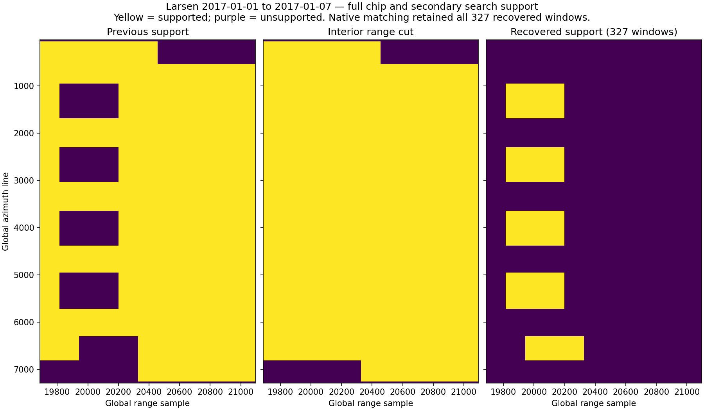
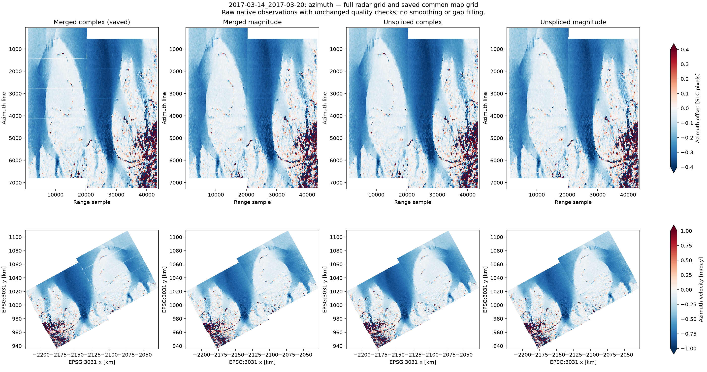
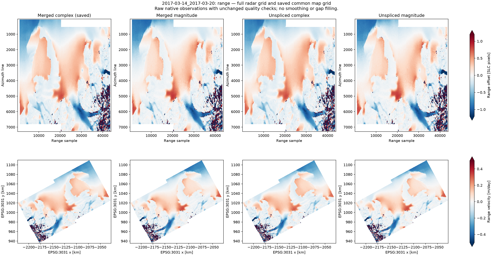

# PIG stack burst-boundary investigation — 2026-10-22

The January 18–24 boundary bands are present in the radar offsets before
geocoding. A controlled native experiment identifies an amplitude notch at the
current SLC ownership switch as a cause of false low-displacement estimates.
Moving the switch into the overlap removes the clearest band. The original
investigation left production products unchanged. The subsequent implementation
and full-AOI validation are described below; the original stack is preserved.

## Inputs and observed failure

These are the corrected connected-zero-support products in `work/pig/stack`,
with geometry identity
`0f086b2f1613c5623d98c09573e71bdff37b65bed07b162efaab41f4c002d1a6`
and January 18–24 match identity
`39db0a19c48eaca33fc5e903937b2d62777360add2b58e6b73ee9a362a187c79`.
There are 22,987 input-valid windows and 22,985 accepted offsets out of 23,607.
The configured SNR and correlation cutoffs are both zero.

Reference-only ownership with later-source precedence switches to each lower
burst's first annotation-valid row:

| Join | Current global cut | End of upper valid support (exclusive) | Experimental midpoint cut |
| --- | ---: | ---: | ---: |
| `139122` → `139123` | 1366 | 1484 | 1425 |
| `139123` → `139124` | 2707 | 2825 | 2766 |

The aligned secondary SLCs have a pronounced amplitude ramp at those first rows.
At the first cut, median amplitudes across range samples 18976–21023 are about
10.6 and 5.8 for January 18 and 24; five rows later they are about 78.3 and 147.3.
The upper bursts remain at normal amplitude across the cut. Splicing the lower
edge into the otherwise supported mosaic inserts a dark notch at the same
reference-grid position on both dates. The notch is an artificial stationary
feature in chips tracking moving ice.

At the saved center `(line, sample) = (1385.5, 20007.5)`, for example:

| Native input | Azimuth offset (px) | SNR | Refined correlation peak |
| --- | ---: | ---: | ---: |
| Upper burst alone | 5.187500 | 24.179 | 0.095 |
| Current merged SLC | 0.171875 | 15.358 | 0.076 |
| Experimental midpoint splice | 5.203125 | 24.067 | 0.095 |
| Current splice, amplitude before oversampling (`deramp=0`) | 0.187500 | 15.358 | 0.079 |

The amplitude-only variant retains the failure. Changing complex deramping alone
therefore does not resolve this example. The evidence supports a splice-induced
matching error; it does not establish independent displacement truth or the
precise resampling-kernel cause of the original burst-edge ramp.


Grey denotes invalid support; white in the displacement panels denotes values
near zero. The experimental result contains observations, without smoothing or
inpainting.

## Executed controls

`tools/investigate_stack_seams.py` read the actual January 18 and January 24
aligned burst SLCs, rather than substituting the January 12 geometry-reference
image. It tested three 384 × 2048 strips at each join, centered at range samples
8000, 14000 and 20000. Each strip uses exactly the saved production matching
centers and settings: 64 × 256 chips, ±10 × ±40 search, 32 × 128 stride, zero
gross offsets, native CPU Ampcor and the saved oversampling settings.

Five alternatives per strip give **30 completed native calls** and 741 distinct
centers: upper burst alone, lower burst alone, actual merged SLC, an experimental
midpoint splice, and amplitude-only matching on the actual merged SLC.

- Replaying cropped production inputs agrees with saved offsets within
  **0.015625 px (1/64)** in both components. Most replay comparisons are exact.
- **1,053 same-source controls are exact**: 546 for current ownership and 507
  for midpoint ownership. These count comparisons, not distinct independent
  measurements. They use complete chip/search footprints from the same original
  burst, excluding each candidate's splice.
- In the fast-moving first-join strip centered at range 20000, **11 of 26**
  observations in the two affected rows differ from upper-only azimuth tracking
  by more than one pixel. Their SNR ranges from 7.63 to 20.40, so an SNR ≥ 5 rule
  would retain them. Their correlation peaks are 0.072–0.094.
- At those same 26 centers, the largest midpoint-versus-upper azimuth difference
  is **0.015625 px**, compared with **5.234375 px** for the current splice.
- Midpoint-crossing observations in that strip have maximum azimuth difference
  **0.171875 px** from upper-only tracking where both are valid. The range
  component still has a discrepancy as large as 1.171875 px. Moving the cut is
  therefore not a demonstrated cure for every component or observation.
- The second join also has edge-related changes, particularly in the strip
  centered at range 14000. Some observations remain inconsistent after moving
  the cut. The low-correlation strip at range 8000 around the first join has
  large disagreements under multiple alternatives; these cannot be interpreted
  as known displacement errors or used to claim midpoint accuracy.
- One sample at the second cut in the range-20000 strip retains the upper
  source under actual reference-support ownership. Thus its actual mosaic
  differs from a simple rectangular splice by one pixel on each date. The
  experiment tracks the actual mosaic and records this exception; the replay
  and same-source controls still pass.
- Source file sizes and nanosecond modification times are unchanged.

The complete numerical record, matching settings and source metadata are in
[native-comparison/report.json](native-comparison/report.json). Saved NPZ arrays
and six figures are generated locally alongside it.

## Why the filtered gradient plots missed the clearest band

The existing gradient inspection uses SNR ≥ 5 and correlation peak ≥ 0.2.
Only four and eleven same-column background comparisons survive at the two
January 18–24 joins. Those surviving derivatives are small, but the correlation
cutoff removes the moving-ice examples above, including the successful
independent tracking estimates. That diagnostic subset cannot establish that
the unfiltered product has no boundary artifact. Both zero-cutoff and filtered
views are needed. Geocoding currently uses the input mask, so tightening a
diagnostic threshold alone would not alter the delivered displacement raster.

## Implemented follow-up

Stack method `stack-reference-interior-ownership-v3` now partitions each shared
reference support rectangle at its azimuth midpoint. Every cut must be at least
eight SLC lines from both overlap edges; overlaps narrower than 16 lines fail
with a clear error. Unshared range coverage, non-overlapping bursts and gaps
retain their extent. Assigned reference holes remain nodata, and missing date
data never changes the source choice. Isolated quantized zeros remain valid.

Original `valid_window` bounds are retained for provenance. Disjoint local
`ownership_windows` describe the actual copy regions, including unequal range
extents; geometry VRTs and source ownership use these same regions. The policy
and exact global cut positions are recorded in the geometry/pair manifests.
Seam flags still inspect complete reference chips and secondary search support.

The reference specification includes the ownership policy. Older pinned roots
are rejected before scientific mutation, including with `--force`. Run a fresh
production stack with:

```bash
glacier-offsets stack run configs/stack.pig.interior.yaml --backend cpu
```

This uses `work/pig/stack-interior`. The separate local validation writes to
`work/pig/stack-interior-validation`, reusing the existing aligned burst files
without rerunning COMPASS. It calls the production ownership writer, date
assembler, native matcher and geocoder for all three dates and both pairs.
Its source products remain read-only. The machine-readable results are in
[interior-validation.json](interior-validation.json).

Regression validation: **141 tests ran in 121.845 seconds, no failures/errors,
two GPU skips**. New checks cover unequal-range overlap partitions, triple
overlaps, narrow-overlap rejection, preserved gaps, consistent geometry,
reference holes, missing date bursts, known motion through secondary-edge
amplitude notches, and rejection of a legacy pin before any mutation.

Full-AOI validation completed on both real pairs:

| Pair | Accepted offsets, before → after | Unchanged-source controls | Largest control difference |
| --- | ---: | ---: | ---: |
| January 12–18 | 22,858 → 22,858 | 21,238 | 0.015625 px |
| January 18–24 | 22,985 → 22,985 | 21,356 | 0.015625 px |

Both 421 × 508 map grids retain their original EPSG:3031 transform and 200 m
spacing. Input-valid counts are also unchanged. Original stack files retain
their sizes and nanosecond modification times. The example at
`(1385.5, 20007.5)` now measures **5.203125 px**, compared with **0.171875 px**
before the change. Thus the full-AOI run reproduces the bounded experiment.

A descriptive same-column neighbor check finds 50 → 3 near-zero azimuth
outliers around the first old cut and 12 → 0 around the second old cut in the
January 18–24 pair. Neighbor-supported populations differ slightly between
versions; these counts are diagnostics, not independent accuracy estimates.
Some range-component and low-correlation disagreements remain. The full map
comparison shows the narrow false azimuth stripe strongly reduced.


Regenerated displacement maps are available locally under
`work/pig/stack-interior-validation/pairs/<pair>/geo/`. Reproduce this isolated
validation, choosing an unused output directory, with:

```bash
PYTHONPATH=src:.runtime/deps MPLCONFIGDIR=.runtime/matplotlib OMP_NUM_THREADS=2 \
  /Users/briel/miniforge3/envs/isce3/bin/python tools/validate_stack_seam_fix.py \
  work/pig/stack --output work/pig/stack-interior-validation \
  --report docs/stack-processing/boundary-investigation/interior-validation.json
```

An interior cut addresses the demonstrated edge-notch mechanism; it does not
make low-correlation measurements reliable or establish independent velocity
accuracy. Threshold changes cannot repair a splice-biased measurement.

## Cross-swath support: Larsen, 2017-01-01–2017-01-07

The azimuth-only policy also split IW1/IW2 overlaps in time. On this pair,
the selected IW2 source contained a 15-sample strip of zero fill at its
near-range edge, although IW1 supported that coverage. Complete secondary search
windows therefore failed in a dashed band along the swath boundary.

`reference-swath-interior-midpoint-v2` retains azimuth midpoint cuts within each
swath, then partitions neighboring swath support unions at their range midpoint.
The Larsen IW1/IW2 cut is at global samples 20295–20390, inside the shared range
coverage. A rectangle-edge sweep preserves coverage at staggered burst junctions;
the partition must have no overlaps or lost coverage. Geometry and both dates'
SLCs use the same fixed source ownership. Actual missing samples remain masked.

An isolated test reused the original aligned bursts without running COMPASS or
changing production files. Full chip/search support increased from 69,348 to
69,675 of 77,634 windows: **327 recovered, none lost**. Native CPU matching in
the boundary strip retained all 327 recovered windows. Its 1,286 unchanged-source
controls differed from the saved offsets by at most 0.015625 pixels, below the
configured 1/32-pixel correlation sampling interval. These checks establish
support recovery and control agreement, without independent displacement truth.
See [the report](swath-validation.json) and the support comparison below.



```bash
PYTHONPATH=src:.runtime/deps MPLCONFIGDIR=/tmp/glacier-mpl OMP_NUM_THREADS=2 \
  /Users/briel/miniforge3/envs/isce3/bin/python tools/validate_swath_ownership.py \
  /Volumes/thinkplus/insar/glacier_offsets/work/larsen/stack \
  --pair 2017-01-01_2017-01-07 \
  --output /path/to/new-swath-validation --native-samples 19700 21100
```

The policy change invalidates the pinned stack reference specification. Normal
processing rejects it before mutation, including with `--force`. The explicit
`stack rebuild-layout CONFIG` command can migrate the previous midpoint policy
in place, preserving verified COMPASS products while clearing date assemblies
and pair outputs. See the detailed reference for dry-run and restart commands.
The isolated validation directory above is not a production stack.

## Full-pair amplitude experiment: Larsen, 2017-03-14–2017-03-20

The matcher already uses amplitude correlation. The preprocessing distinction
is when magnitude detection happens: `deramp=1` interpolates complex SLC data
before amplitude correlation; `deramp=0` takes magnitude before interpolation.
Neither option estimates displacement by interferometric phase matching.

An isolated CPU experiment compared four combinations on the entire **227 × 342
grid (77,634 windows)**, covering ten aligned bursts in IW1 and IW2:

| Inputs | Interpolation | Input-valid windows | Quality-valid offsets |
| --- | --- | ---: | ---: |
| Saved merged baseline | Complex, then magnitude (`deramp=1`) | 69,669 | 69,662 |
| Reassembled merged SLCs | Magnitude first (`deramp=0`) | 69,669 | 69,663 |
| Original unspliced bursts | Complex, then magnitude (`deramp=1`) | 69,666 | 69,659 |
| Original unspliced bursts | Magnitude first (`deramp=0`) | 69,666 | 69,660 |

All variants retain the saved global centers, ownership, geometry, chip/search
sizes, stride, zero gross offsets, and quality thresholds. The original aligned
SLCs were verified against their recorded checksums. Unspliced workers also
retain observations from both burst views of an overlap for diagnostic
comparison; the published result selects only the fixed owning source. No
source substitution, averaging, smoothing or gap filling is used. Three extra
windows fail the requirement that the complete chip/search footprint fit the
selected burst's genuine support.

**Unspliced burst matching with the current `deramp=1` preprocessing is an
experimental candidate, not a validated production fix.** Its maps strongly
reduce the narrow near-zero along-track burst stripes while preserving the
large-scale motion patterns, but retain cross-swath discontinuities (see the
ISCE2 merge audit below). For 50,930 valid,
correlation ≥ 0.3, non-seam control centers, both offset components differ from
the saved baseline by at most **0.015625 pixels**; their median and 99th-percentile
absolute differences are zero.

An internal overlap check selects centers where both original burst views have
correlation ≥ 0.5 and agree within 1/16 azimuth and 1/8 range pixel. There are
709 centers meeting those criteria under **both** preprocessing modes. Against
the complex-interpolated burst-view consensus:

| Inputs / preprocessing | Median absolute azimuth discrepancy (px) | 90th percentile (px) |
| --- | ---: | ---: |
| Saved merged / complex interpolation | 0.015625 | 0.0859375 |
| Merged / magnitude first | 0.015625 | 0.0390625 |
| Unspliced / complex interpolation | 0.0078125 | 0.015625 |
| Unspliced / magnitude first | 0.015625 | 0.0312500 |

These are consistency checks, **not independent displacement truth**. Using the
magnitude-interpolated consensus instead also reduces the azimuth 90th-percentile
discrepancy for unspliced complex inputs, from 0.078125 to 0.031250 pixels.
The complete report retains both reference choices and per-overlap results.
Low-correlation/noisy areas remain; no blanket accuracy claim follows.

Magnitude-first processing reduces visible seams even with merged inputs, but
has a separate interpolation tradeoff. Known range-only Fourier translations
of real complex tiles from each swath tested shifts −0.375, +0.3 and −3.375
pixels, with 300 accepted windows per case and mode. Median absolute range
errors are **0–0.003125 pixels** with the current complex interpolation versus
**0.046875–0.096875 pixels** with magnitude first. These noiseless synthetic
controls isolate range interpolation; they do not reproduce temporal
decorrelation or validate glacier velocity. An earlier exploratory mixed
azimuth/range shift trial failed to establish azimuth accuracy under either
mode and is excluded from method selection. Its raw report is retained locally
under `seam_investigation/march2017/known-shifts/`.





The top rows show radar offsets and the bottom rows show geocoded velocities
on the original common map grid. Each row uses the same color limits across
variants. Display interpolation is nearest neighbor. Figures use the same raw
quality-valid observations without additional filtering.

The [numerical report](larsen-march2017-comparison.json) preserves the settings,
input provenance, full comparison statistics, and range-shift controls. Full
HDF5, GeoTIFF and overlap-observation products are retained locally in
`seam_investigation/march2017/full-pair/`; the recommended maps are in its
`unspliced_complex/geo/` directory. Consumed production files retained their
sizes and nanosecond modification times. Production defaults and algorithms
are unchanged by this experiment. This is a native ISCE3 comparison, not an
end-to-end ISCE2 validation.

Reproduce with unused experiment directories (the pair must retain its aligned
burst SLCs and saved center geometry):

```bash
PAIR=/Volumes/thinkplus/insar/glacier_offsets/work/larsen/stack/pairs/2017-03-14_2017-03-20
PYTHONPATH=src:tests:.runtime/deps MPLCONFIGDIR=/tmp/glacier-mpl OMP_NUM_THREADS=8 \
  /Users/briel/miniforge3/envs/isce3/bin/python tools/compare_stack_matching.py \
  "$PAIR" --output /path/to/new-full-pair-experiment --workers 8
MPLCONFIGDIR=/tmp/glacier-mpl \
  /Users/briel/miniforge3/envs/ice/bin/python tools/summarize_stack_matching.py \
  /path/to/new-full-pair-experiment
PYTHONPATH=src:.runtime/deps MPLCONFIGDIR=/tmp/glacier-mpl OMP_NUM_THREADS=4 \
  /Users/briel/miniforge3/envs/isce3/bin/python tools/validate_ampcor_preprocessing.py \
  "$PAIR" --output /path/to/new-range-shift-controls
```

The first command supports `--resume` for a matching experiment with unchanged
input provenance and settings. All writes go to the requested isolated output.

## ISCE2 merge audit and remaining swath differences

The full-pair experiment above is not equivalent to the ISCE2 offset workflow.
Source review followed `mergeBursts.py:main` through `mergeBurstsVirtual` to
`VRTManager.VRTConstructor.addSwath/addBurst`, and the upstream validity
preparation in `resamp_withCarrier.py`, `s1a_isce_utils.py`, and
`extractCommonValidRegion.py`.

| Choice | ISCE2 topsStack | Current project stack |
| --- | --- | --- |
| Active merge path | VRT `SimpleSource` rectangles, optionally materialized | Materialized SLC using a fixed ownership raster |
| Overlap choice | Later sources overwrite earlier sources; swaths added IW1, IW2, IW3 | Azimuth midpoint within swaths and range midpoint between swaths |
| Valid rectangles | Resampled secondary validity adjusted for mapping offsets and interpolation margins; intersected across the stack and supplied to merges with `--stack` | Reference annotation intersected with its nonzero support bounds; individual dates subsequently masked for actual missing samples |
| Grid placement | Rounded integer offsets from reference sensing time and slant range | Same coordinate principle, with an additional fractional-placement tolerance check |
| Merge interpolation/blending | None in the active VRT path | None in the production SLC copy |
| Offset estimator | ISCE2 CPU DenseAmpcor using magnitude input | ISCE3 Ampcor, currently complex interpolation before amplitude correlation |

`mergeBursts.py` contains a separate numpy `mergeBursts` function implementing
`top/bot/avg`, but `main` calls the VRT path regardless of `--method`. Thus its
`--method top` configuration is not evidence of upper-burst precedence or
averaging in the actual stack merge. Reference and secondary SLC merge
configurations in the inspected local `Stack.py` both supply the common stack
validity directory; `aligned` selects the reference grid for secondary extents.
The SLC workflow disables multilooking at this stage.

A direct execution of the official `VRTManager.py` with this pair's integer
placements and reference rectangles confirms later-source precedence exactly
against sequential rectangle copies. Relative to our current masked owner
raster, **11,844,809 SLC pixels and 2,895 matching centers select a different
burst**. There are also 44 rectangle-versus-mask coverage differences. Using
these same reference rectangles, IW2 begins overwriting IW1 at samples 20023
or 20114, whereas our midpoint range cuts are 20295, 20344, or 20390. This
isolates the policy difference; it does not recreate ISCE2's actual common
valid rectangles, coregistered SLCs or matching results.

The earlier 709 overlap controls deliberately selected agreeing burst views.
They cannot establish that all swath transitions are resolved. A new comparison
uses the saved separate-burst observations with no agreement requirement.
For example, with both correlation peaks ≥ 0.5, the IW1/IW2 views for burst
080978 differ in azimuth by a median **+0.03125 pixels** across 38 centers under
complex interpolation, and +0.03125 pixels across 37 centers under magnitude
first. Across several other cross-swath overlaps, positive median differences
of 0.015625–0.03125 pixels remain; some areas have larger discrepancies.
These differences already exist in the unspliced radar estimates, before their
offset fields are combined or geocoded. They do not, by themselves, identify
the source of the discrepancy or establish which swath is correct.

The previous recommendation to adopt unspliced matching was therefore too
strong. The next controlled comparison should retain merge-first processing
and test ISCE2-equivalent validity, overlap precedence and actual magnitude
matching on the same inputs before choosing a production algorithm. The
current range-only synthetic controls do not establish equivalence between
ISCE3 `deramp=0` and ISCE2 CPU DenseAmpcor, or validate absolute azimuth motion.
No production behavior is changed by this audit.

The [audit report](larsen-march2017-isce2-merge-audit.json) records the official
source checksums, local checkout commit, ownership counts and all overlap
differences at correlation thresholds 0, 0.3, and 0.5. Reproduce using the saved
full-pair experiment and an unused output directory:

```bash
/Users/briel/miniforge3/envs/isce3/bin/python tools/audit_isce2_merge.py \
  seam_investigation/march2017/full-pair \
  --isce2 /Users/briel/src/isce2-official --output /path/to/new-merge-audit
```

## Reproduce the along-track investigation

```bash
PYTHONPATH=src:.runtime/deps MPLCONFIGDIR=.runtime/matplotlib OMP_NUM_THREADS=2 \
  /Users/briel/miniforge3/envs/isce3/bin/python tools/investigate_stack_seams.py \
  work/pig/stack/pairs/2020-01-18_2020-01-24 \
  --output docs/stack-processing/boundary-investigation/native-comparison
```

Append `--analyse-only` to regenerate reports/figures from the saved NPZ arrays
without native matching. It requires the arrays from a completed experiment.
The separate derivative figures were generated with
`tools/inspect_seam_gradients.py` for both existing pairs.
