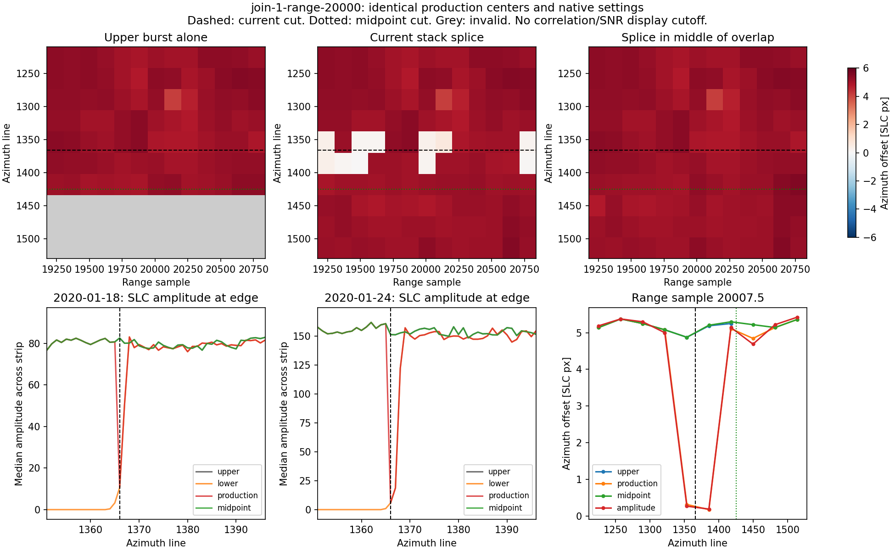
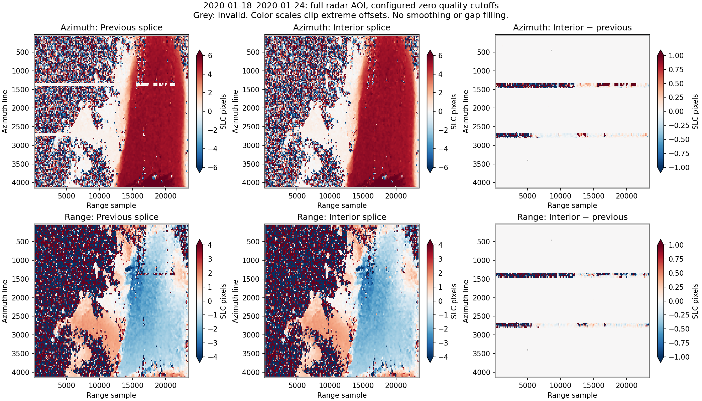

# PIG stack burst-boundary investigation — 2026-10-22

The January 18–24 boundary bands are present in the radar offsets before
geocoding. A controlled native experiment identifies an amplitude notch at the
current SLC ownership switch as a cause of false low-displacement estimates.
Moving the switch into the overlap removes the clearest band. The original
investigation left production products unchanged. The subsequent implementation
and full-AOI validation are described below; the original stack is preserved.

## Inputs and observed failure

These are the corrected connected-zero-support products in `work/pig/stack`,
with geometry identity
`0f086b2f1613c5623d98c09573e71bdff37b65bed07b162efaab41f4c002d1a6`
and January 18–24 match identity
`39db0a19c48eaca33fc5e903937b2d62777360add2b58e6b73ee9a362a187c79`.
There are 22,987 input-valid windows and 22,985 accepted offsets out of 23,607.
The configured SNR and correlation cutoffs are both zero.

Reference-only ownership with later-source precedence switches to each lower
burst's first annotation-valid row:

| Join | Current global cut | End of upper valid support (exclusive) | Experimental midpoint cut |
| --- | ---: | ---: | ---: |
| `139122` → `139123` | 1366 | 1484 | 1425 |
| `139123` → `139124` | 2707 | 2825 | 2766 |

The aligned secondary SLCs have a pronounced amplitude ramp at those first rows.
At the first cut, median amplitudes across range samples 18976–21023 are about
10.6 and 5.8 for January 18 and 24; five rows later they are about 78.3 and 147.3.
The upper bursts remain at normal amplitude across the cut. Splicing the lower
edge into the otherwise supported mosaic inserts a dark notch at the same
reference-grid position on both dates. The notch is an artificial stationary
feature in chips tracking moving ice.

At the saved center `(line, sample) = (1385.5, 20007.5)`, for example:

| Native input | Azimuth offset (px) | SNR | Refined correlation peak |
| --- | ---: | ---: | ---: |
| Upper burst alone | 5.187500 | 24.179 | 0.095 |
| Current merged SLC | 0.171875 | 15.358 | 0.076 |
| Experimental midpoint splice | 5.203125 | 24.067 | 0.095 |
| Current splice, amplitude before oversampling (`deramp=0`) | 0.187500 | 15.358 | 0.079 |

The amplitude-only variant retains the failure. Changing complex deramping alone
therefore does not resolve this example. The evidence supports a splice-induced
matching error; it does not establish independent displacement truth or the
precise resampling-kernel cause of the original burst-edge ramp.



Grey denotes invalid support; white in the displacement panels denotes values
near zero. The experimental result contains observations, without smoothing or
inpainting.

## Executed controls

`tools/investigate_stack_seams.py` read the actual January 18 and January 24
aligned burst SLCs, rather than substituting the January 12 geometry-reference
image. It tested three 384 × 2048 strips at each join, centered at range samples
8000, 14000 and 20000. Each strip uses exactly the saved production matching
centers and settings: 64 × 256 chips, ±10 × ±40 search, 32 × 128 stride, zero
gross offsets, native CPU Ampcor and the saved oversampling settings.

Five alternatives per strip give **30 completed native calls** and 741 distinct
centers: upper burst alone, lower burst alone, actual merged SLC, an experimental
midpoint splice, and amplitude-only matching on the actual merged SLC.

- Replaying cropped production inputs agrees with saved offsets within
  **0.015625 px (1/64)** in both components. Most replay comparisons are exact.
- **1,053 same-source controls are exact**: 546 for current ownership and 507
  for midpoint ownership. These count comparisons, not distinct independent
  measurements. They use complete chip/search footprints from the same original
  burst, excluding each candidate's splice.
- In the fast-moving first-join strip centered at range 20000, **11 of 26**
  observations in the two affected rows differ from upper-only azimuth tracking
  by more than one pixel. Their SNR ranges from 7.63 to 20.40, so an SNR ≥ 5 rule
  would retain them. Their correlation peaks are 0.072–0.094.
- At those same 26 centers, the largest midpoint-versus-upper azimuth difference
  is **0.015625 px**, compared with **5.234375 px** for the current splice.
- Midpoint-crossing observations in that strip have maximum azimuth difference
  **0.171875 px** from upper-only tracking where both are valid. The range
  component still has a discrepancy as large as 1.171875 px. Moving the cut is
  therefore not a demonstrated cure for every component or observation.
- The second join also has edge-related changes, particularly in the strip
  centered at range 14000. Some observations remain inconsistent after moving
  the cut. The low-correlation strip at range 8000 around the first join has
  large disagreements under multiple alternatives; these cannot be interpreted
  as known displacement errors or used to claim midpoint accuracy.
- One sample at the second cut in the range-20000 strip retains the upper
  source under actual reference-support ownership. Thus its actual mosaic
  differs from a simple rectangular splice by one pixel on each date. The
  experiment tracks the actual mosaic and records this exception; the replay
  and same-source controls still pass.
- Source file sizes and nanosecond modification times are unchanged.

The complete numerical record, matching settings and source metadata are in
[native-comparison/report.json](native-comparison/report.json). Saved NPZ arrays
and six figures are generated locally alongside it.

## Why the filtered gradient plots missed the clearest band

The existing gradient inspection uses SNR ≥ 5 and correlation peak ≥ 0.2.
Only four and eleven same-column background comparisons survive at the two
January 18–24 joins. Those surviving derivatives are small, but the correlation
cutoff removes the moving-ice examples above, including the successful
independent tracking estimates. That diagnostic subset cannot establish that
the unfiltered product has no boundary artifact. Both zero-cutoff and filtered
views are needed. Geocoding currently uses the input mask, so tightening a
diagnostic threshold alone would not alter the delivered displacement raster.

## Implemented follow-up

Stack method `stack-reference-interior-ownership-v3` now partitions each shared
reference support rectangle at its azimuth midpoint. Every cut must be at least
eight SLC lines from both overlap edges; overlaps narrower than 16 lines fail
with a clear error. Unshared range coverage, non-overlapping bursts and gaps
retain their extent. Assigned reference holes remain nodata, and missing date
data never changes the source choice. Isolated quantized zeros remain valid.

Original `valid_window` bounds are retained for provenance. Disjoint local
`ownership_windows` describe the actual copy regions, including unequal range
extents; geometry VRTs and source ownership use these same regions. The policy
and exact global cut positions are recorded in the geometry/pair manifests.
Seam flags still inspect complete reference chips and secondary search support.

The reference specification includes the ownership policy. Older pinned roots
are rejected before scientific mutation, including with `--force`. Run a fresh
production stack with:

```bash
glacier-offsets stack run configs/stack.pig.interior.yaml --backend cpu
```

This uses `work/pig/stack-interior`. The separate local validation writes to
`work/pig/stack-interior-validation`, reusing the existing aligned burst files
without rerunning COMPASS. It calls the production ownership writer, date
assembler, native matcher and geocoder for all three dates and both pairs.
Its source products remain read-only. The machine-readable results are in
[interior-validation.json](interior-validation.json).

Regression validation: **141 tests ran in 121.845 seconds, no failures/errors,
two GPU skips**. New checks cover unequal-range overlap partitions, triple
overlaps, narrow-overlap rejection, preserved gaps, consistent geometry,
reference holes, missing date bursts, known motion through secondary-edge
amplitude notches, and rejection of a legacy pin before any mutation.

Full-AOI validation completed on both real pairs:

| Pair | Accepted offsets, before → after | Unchanged-source controls | Largest control difference |
| --- | ---: | ---: | ---: |
| January 12–18 | 22,858 → 22,858 | 21,238 | 0.015625 px |
| January 18–24 | 22,985 → 22,985 | 21,356 | 0.015625 px |

Both 421 × 508 map grids retain their original EPSG:3031 transform and 200 m
spacing. Input-valid counts are also unchanged. Original stack files retain
their sizes and nanosecond modification times. The example at
`(1385.5, 20007.5)` now measures **5.203125 px**, compared with **0.171875 px**
before the change. Thus the full-AOI run reproduces the bounded experiment.

A descriptive same-column neighbor check finds 50 → 3 near-zero azimuth
outliers around the first old cut and 12 → 0 around the second old cut in the
January 18–24 pair. Neighbor-supported populations differ slightly between
versions; these counts are diagnostics, not independent accuracy estimates.
Some range-component and low-correlation disagreements remain. The full map
comparison shows the narrow false azimuth stripe strongly reduced.



Regenerated displacement maps are available locally under
`work/pig/stack-interior-validation/pairs/<pair>/geo/`. Reproduce this isolated
validation, choosing an unused output directory, with:

```bash
PYTHONPATH=src:.runtime/deps MPLCONFIGDIR=.runtime/matplotlib OMP_NUM_THREADS=2 \
  /Users/briel/miniforge3/envs/isce3/bin/python tools/validate_stack_seam_fix.py \
  work/pig/stack --output work/pig/stack-interior-validation \
  --report docs/stack-processing/boundary-investigation/interior-validation.json
```

An interior cut addresses the demonstrated edge-notch mechanism; it does not
make low-correlation measurements reliable or establish independent velocity
accuracy. Threshold changes cannot repair a splice-biased measurement.

## Reproduce

```bash
PYTHONPATH=src:.runtime/deps MPLCONFIGDIR=.runtime/matplotlib OMP_NUM_THREADS=2 \
  /Users/briel/miniforge3/envs/isce3/bin/python tools/investigate_stack_seams.py \
  work/pig/stack/pairs/2020-01-18_2020-01-24 \
  --output docs/stack-processing/boundary-investigation/native-comparison
```

Append `--analyse-only` to regenerate reports/figures from the saved NPZ arrays
without native matching. It requires the arrays from a completed experiment.
The separate derivative figures were generated with
`tools/inspect_seam_gradients.py` for both existing pairs.
